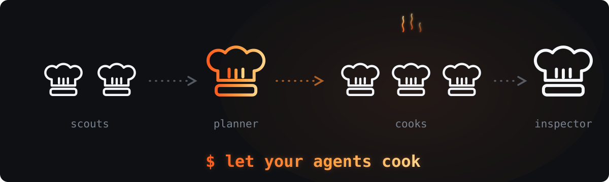
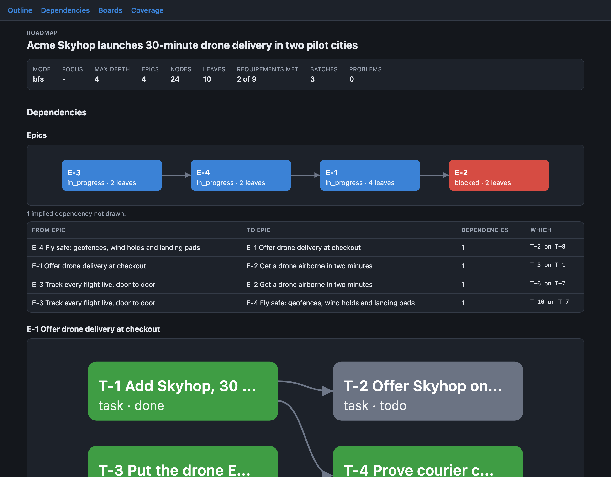

A Claude Code **plugin** that turns your session into the planner of a cheap, parallel
coding fleet.

Point it at a task board (Notion, ClickUp, an Obsidian vault, or a folder of markdown files)
and pick a ticket. Scouts research the codebase in parallel, the planner breaks the ticket
into small disjoint work packets, cooks implement them in isolated git worktrees, an
inspector adversarially reviews every diff before it lands, and you get one PR to review.

You have two jobs: approve the plan, and review the PR.

## Why

The expensive model is the scarce resource. Brigade spends it on the one thing only it can
do, decomposition, and pushes everything else onto cheap subagents.

That only works if the packets are good. A weak model told to "add rate limiting to login"
produces garbage; the same model handed three named files, the contracts it needs pasted
in, and the exact command that proves it done produces mergeable code. So every claim needs
real command output as evidence, nothing lands without an inspector PASS, and blocked work
comes back as a decision-ready question instead of a guessed value.

## How it works



A **dish** is one ticket cooked to completion:

1. **Research.** Scouts answer focused questions about the codebase and write short briefs.
2. **Plan.** The planner writes `PLAN.md`, a dependency graph of small work items, and
   stops for your approval.
3. **Cook and inspect.** Cooks implement items in parallel worktrees; an inspector rules
   PASS or FAIL on each diff, and a FAIL climbs an escalation ladder to a stronger cook.
4. **Land and hand off.** Passed items land in dependency order on one delivery branch, the
   gate and an acceptance pass run at full scope, a red team reviews the whole range, and
   one PR opens.
5. **Retro.** An analyst reviews how the dish ran and feeds lessons back into the next one.

Deterministic Workflow scripts drive the fleet, so control flow lives in code rather than in
a model deciding what to do next. State lives in `PLAN.md` and a typed report trail on disk,
so any session can resume mid-run and nothing already landed is cooked twice. Pick how much
model a dish buys with [service tiers](docs/tiers.md): say `brigade heavy` or
`brigade light` for one dish.

## Roadmaps

New in 0.53.0: `/brigade:roadmap` plans work too big for one ticket. It grills the intent,
inventories the affected systems with read-only scouts, proposes epics, and drills them down
in rounds you confirm until each leaf is a ready ticket on your board. Nothing cooks during
a roadmap session; a dish starts when you pick a published leaf.

`brigade-roadmap-view` renders the whole roadmap as one offline HTML page: an outline,
the dependency graph, a board per epic, and coverage of the systems and requirements.



Read the [roadmap guide](docs/roadmap.md) or walk through the
[roadmap demo](docs/roadmap-demo.md).

## Install

```bash
claude plugin marketplace add jimador/brigade
claude plugin install brigade@brigade
```

Then, in a repo, run `/brigade:onboard` (or say `set up brigade`), and once that is done,
say `work my board`. Requirements, updating, and upgrading open work across versions are on
the [installation page](docs/installation.md).

## Documentation

- [Quickstart](docs/quickstart.md): from nothing to a landed change in ten minutes.
- [Concepts](docs/concepts.md): the nouns, one or two sentences each.
- [Run a dish](docs/usage.md): start, approve, resume and hand off a dish. Every command is in [Commands](docs/commands.md) and every helper in [Scripts](docs/scripts.md).
- [Configuration](docs/configuration.md) and [overrides](docs/overrides.md): settings
  layers and prompt overrides.
- [Architecture](docs/architecture.md): the pipeline, the roles, and why it is built
  this way.
- [All docs](docs/index.md)

Contributing: see [CONTRIBUTING.md](CONTRIBUTING.md).

## License

MIT. See [LICENSE](LICENSE).
