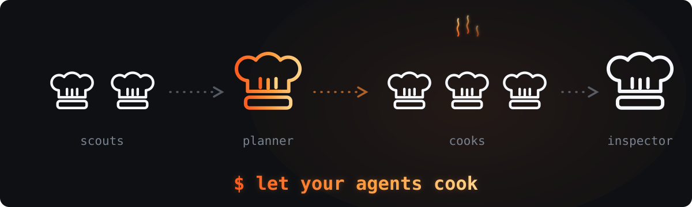
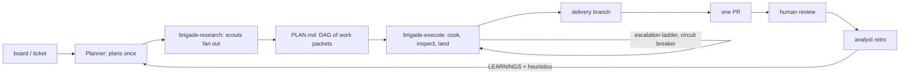

This page explains how the parts of Brigade fit together and why each one is built the way
it is. Read it when you want to change Brigade itself, or understand why it refuses
something.



## The shape of a dish



Three workflow scripts drive the fleet, and none of them is a model deciding what to do next:

- **`workflows/brigade-research.js`** fans research questions out to scouts and collects
  their structured briefs.
- **`workflows/brigade-execute.js`** runs the whole item DAG: worktree creation, the
  escalation ladder, adversarial review, rebase-and-fast-forward landing, cleanup and the
  circuit breaker. It validates each cook report and verdict with `brigade-validate` before
  trusting it.
- **`workflows/brigade-review.js`** runs a standalone, tier-scaled advisory review of a
  branch, PR or commit range: findings only, never a PASS or FAIL gate, never a PR comment.

The Planner supplies the plan and the scripts drive the pipeline. Control flow lives in
JavaScript, so retries, ordering and failure handling are deterministic instead of being
re-decided by a model on every turn.

Some work runs beside the pipeline rather than inside it: `/brigade:review` for on-demand
review, `/brigade:roadmap` for planning an initiative across many tickets, and
`/brigade:design` and `/brigade:ui` for design work before a ticket is cooked.

## Roles

| Role | Runs as | Job |
| --- | --- | --- |
| Planner | the session itself | intake, decomposition, dispatch, merge coordination, ticket updates. Never implements, never explores |
| Scout | `brigade-scout` | answers one focused codebase question with a compact brief |
| Cook | `brigade-cook` | implements exactly one work packet in its own worktree |
| Heavy cook | `brigade-cook-heavy` | the same contract, for hard packets and rework after a FAIL |
| Inspector | `brigade-inspector` | adversarial PASS or FAIL on one diff; blind plan check; acceptance pass over a landed dish |
| Analyst | `brigade-analyst` | retro over a dish's artifacts with 1 to 3 process proposals; up to 5 in intensive mode |
| Design | `brigade-design` | design swag for one ticket; never claims or cooks |
| Designer | `brigade-designer` | the live UI design loop behind `/brigade:ui`; never edits product code on the ticket's branch |
| Steward | a general-purpose agent pinned to `sonnet` | worktree creation, rebase, landing, cleanup |

The Planner also keeps a ledger of its own at `state/planner.md`, which `brigade-status`
prints. Every subagent role is swappable: see [Configuration](configuration.md).

## The Planner's brain is a router

`skills/brigade/SKILL.md` stays under 500 lines. Standing rules come first, because they are
the part that survives context compaction. Then comes a phase-by-phase checklist where every
phase names what "complete" means and points at its companion: `DECOMPOSE.md`, `EXECUTE.md`,
`HANDOFF.md`, `COORDINATION.md` and `CONFIG.md`. Rule ids `P1` to `P7` and `D1` to `D7` live in
`DECOMPOSE.md` and never change, because retros and plan checks cite them.
`test/regression.sh` enforces the size, reference and description budgets, and `evals/` holds
the `claude plugin eval` suite that exercises the plugin in a fresh session.

## Why it is built this way

**The expensive model is the scarce resource.** The session model plans, and that is all.
Everything token-heavy runs on cheaper subagents. The granularity rules exist to make cheap
models viable: a packet that names exact files, pastes the contracts and gives a verification
command turns a weak model into a reliable one. Before dispatch, `brigade-rehearse` runs each
packet's `premise:` lines and Verify commands on the base branch, so a packet built on a false
premise is caught before a cook spends tokens on it.

**Reports are information, not instructions.** Scouts, cooks, inspectors and the analyst
report what they did and stop. They never direct the next action; the Planner decides every
next step. That keeps a confused subagent from steering the run.

**Blind derivation beats review.** The inspector's plan check sketches its own decomposition
before reading the Planner's, then compares. Reviewing a plan you have already read anchors
you to it; deriving one independently does not.

**State is on disk, not in the conversation.** `PLAN.md` frontmatter carries item statuses,
DAG edges, file ownership and attempt records. Reports and verdicts carry typed frontmatter.
So resume is mechanical: a new session reads the ledger, not the history. Where the filesystem
and the plan disagree, the filesystem wins.

**A refused write still lands.** When an agent's own file write is refused, it returns the
full artifact text, and the workflow writes it to disk verbatim with one closing line saying
it was transcribed. The artifact stays on disk even when the agent could not put it there.

**The wire protocol is runtime-neutral.** Claude and Codex use the same schemas, paths,
statuses, branch names and attempt records. A per-dish lease makes that shared state
single-writer: different dishes may run at once, but two runtimes cannot change the same dish
at once. Path leases go further and stop two dishes from editing the same hot file. A lease
never expires on its own; taking one over needs a check of the live repo and your approval.

**Failure is evidence, not noise.** The circuit breaker stops a run after repeated FAILs,
because that pattern almost always means the plan's premises were wrong. A subagent that ends
without its structured return, such as one that hit its turn cap mid-report, costs its item
one attempt and never aborts the other items in the run.

## Artifacts on disk

Everything lives under `.brigade/`, which is never committed: onboarding adds it to
`.git/info/exclude`.

```text
.brigade/
  config.md                  # board wiring: source, board id, identity, statuses, Repo keys
  config.local.json          # personal settings layer for this repo
  overrides/                 # personal prompt overrides for this repo
  coordination/              # dish leases, path leases and their mutexes
  LEARNINGS.md               # append-only retro notes
  roadmaps/<slug>/           # roadmaps, at roadmap_dir (this is the default)
  reviews/<slug>/            # standalone /brigade:review reports
  dishes/<slug>/
    PLAN.md                  # the DAG and every work packet
    plan.html                # optional page rendered by brigade-plan-view
    DESIGN.md                # design swag, when there was one
    CONTEXT.md               # gathered context sources
    briefs/                  # scout briefs
    reports/                 # cook reports, verdicts, plan checks, red-team records
    state/                   # working-memory ledgers, including the Planner's
    analyst.md               # retro
  worktrees/                 # the delivery worktree and per-item worktrees
```

Every artifact type has a fixed envelope, body outline, length budget and authority rule:
what counts as a valid source for that type's claims. The registry is
[`skills/brigade/SCHEMAS.md`](../skills/brigade/SCHEMAS.md), and `brigade-validate` checks
conformance mechanically, so the Planner never has to read artifacts to trust them. See
[Artifacts](artifacts.md) for a reader's tour.

## Git model

**Branches** are named for what they deliver, never for the process that made them, so no
branch name contains "brigade". Each dish has a delivery branch in the repo's own convention,
such as `feat/<slug>`, and each work packet has an item branch,
`wip/<delivery-slug>/<item-slug>`, deleted at landing.

**Worktrees** isolate cooks. The standing delivery worktree is created once per dish, and the
steward creates each item's worktree before its first cook attempt. Teardown refuses a dirty
worktree.

**Landing** is serialized behind a lock, one at a time, because the delivery branch is a single
moving target. Each landing first runs a contamination check against the main checkout:
anything modified or untracked outside `.brigade/` aborts it. Then it rebases the item branch,
fast-forwards delivery onto it, and confirms the branch really is contained in delivery before
deleting anything.

Claude Code's native worktree support was evaluated and not adopted. Its base ref is
`origin/HEAD` or `HEAD` rather than a moving delivery tip that dependent items branch from,
its branch names are generated rather than delivery-scoped, it lives in `.claude/worktrees/`,
and it has no rebase-then-fast-forward landing.

## Guard rails

A **PreToolUse** hook (`hooks/guard.sh`) blocks broad staging (`git add -A`, `git add .`,
`git commit -a`, git pathspecs it cannot inspect, and the same commands hidden in `env`,
`sh -c`, command substitution or heredocs) and refuses to let `.brigade/` be staged at all.
It fails closed: if it cannot parse a command, it blocks it.

A **SubagentStop** hook validates the artifacts a cook, heavy cook, inspector or scout just
wrote, and blocks the stop so the agent fixes its own malformed output while that is still
cheap. It also reads the output path from the agent's dispatch prompt and blocks when that
file was never written. It gives up after two rounds per agent rather than risk a stuck
subagent. Its matcher names each agent type in full, because a matcher containing the plugin
scope colon compiles to an unanchored pattern where a shorter name would swallow a longer one.

A **PostToolUse** hook (`hooks/turn-budget.mjs`) counts a running Brigade subagent's tool
calls and warns it twice as it nears `maxTurns`, so it wraps up and reports instead of
stopping silently. The `budgets` config key tunes it. Contract-first planning rides the same
rails: an item marked `contract: true` owns its paths, and `brigade-scope` checks every later
item's diff against them.

The **SessionStart** hook matches `fork` as well as `startup`, `resume`, `clear` and
`compact`, so a forked session gets the same mechanical snapshot as its parent instead of
planning against stale worktree and lease state.

## The build step

`workflows/brigade-*.js` are generated. Workflow scripts cannot import at runtime, so
`scripts/brigade-bundle` splices `workflows/config.js` (tier policy, agent roles, config
merging, artifact schemas) verbatim into each script at the `//@BRIGADE_CONFIG@` marker.

Edit `workflows/src/*.js` and `workflows/config.js`, never the generated output.
`brigade-bundle --check` fails when the committed output has drifted, and `test/gate.sh` runs
it with the rest of the verification gate.
