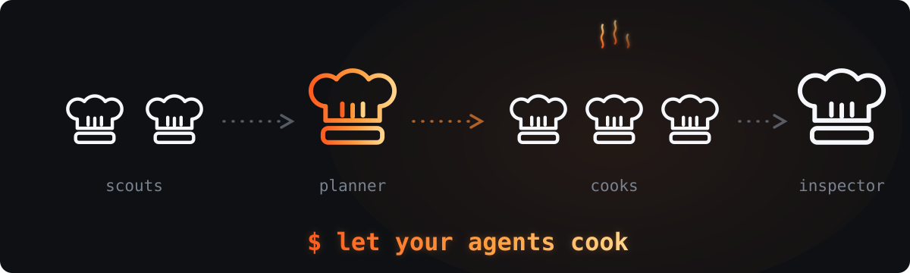

Brigade borrows a few words from a restaurant kitchen and uses each one for exactly one thing. This page defines them in the order you meet them during a run.

## The pipeline at a glance



```text
ticket -> scouts (briefs) -> planner (PLAN.md: DAG of work items)
       -> cooks in worktrees -> inspector verdicts -> landing on the delivery branch
       -> gate + acceptance pass + red team -> one PR -> retro
```

## Work and where it lives

**Ticket.** One unit of work on your board, with a goal and acceptance criteria. Brigade claims it at the start of a dish and moves it to review at the end, commenting in plain language. See [Run a dish](usage.md).

**Board and source.** The board is wherever your tickets live; the source is the adapter Brigade uses to reach it: Notion, ClickUp, an Obsidian vault, or a local folder of markdown files. Every source implements the same four operations. See [Sources](sources.md).

**Dish.** One ticket cooked to completion, from intake to an open PR. Its files live in `.brigade/dishes/<slug>/`, so any session can resume it. See [Run a dish](usage.md).

## Roles

**Planner.** Your Claude Code session. It claims the ticket, decides what research is needed, writes the plan, dispatches the fleet and hands off. It never implements and never explores the codebase itself, because it runs on the most expensive model. See [Architecture](architecture.md).

**Scout and brief.** A scout is a read-only subagent that answers one focused question about the codebase. Its answer is a brief: a short file with the contracts it found pasted in and the exact places it looked. See [Artifacts](artifacts.md).

**Cook and heavy cook.** A cook implements exactly one work packet in its own git worktree, runs the verification commands, commits, and reports with the real output. A heavy cook has the same job on a stronger model, for items flagged hard and for rework after a failed review. See [Run a dish](usage.md).

**Inspector and verdict.** The inspector is an adversarial reviewer that checks one item's diff against its packet and rules PASS or FAIL in a verdict file. Nothing lands without a PASS from a fresh reviewer. See [Architecture](architecture.md).

## The plan

**Work item and the plan DAG.** The planner splits a ticket into work items: small, disjoint pieces of one behavior each. `PLAN.md` holds them as a dependency graph (a DAG), so items without dependencies cook in parallel and items in the same wave never share a file. See [Run a dish](usage.md).

**Packet.** The self-contained instructions for one work item: the one to three files to touch, the contracts pasted in, the steps, and the command that proves it done. A cheap cook given a good packet needs no exploration. See [Artifacts](artifacts.md).

## Getting a change in

**Landing.** Moving a passed item onto the dish's delivery branch, one at a time in dependency order, by rebase and fast-forward only. See [Architecture](architecture.md).

**Gate.** The verification commands your repo trusts, set as `verification_gate` during setup. Cooks paste their real output, and at handoff the planner proves the gate at full scope, because a filtered test run is never treated as the whole suite passing. See [Configuration](configuration.md).

**Red team.** At handoff, a second review over the whole delivery range rather than one item: a find pass in a tool other than the one that wrote the code, then a verify pass in a tool other than the find pass's, with at least one of them in a fresh Claude session. A PR leaves draft only with a clean red-team result on its current head, or a human's override. See [Reviews](reviews.md).

## Running the fleet

**Tiers.** How much model a dish buys: three-star (`brigade heavy`), two-star (the default) or one-star (`brigade light`). A tier sets the planning model, the first-attempt cook, scout caps, the plan check and the retro cadence. See [Tiers](tiers.md).

**Lease.** A per-dish lock that keeps one writer on a dish at a time, so Claude and Codex sessions can work different dishes at once and hand one over at a human checkpoint. Roadmaps and reviews take a lease too. See [Architecture](architecture.md).

**Ledger.** A running record kept on disk. The upgrade ledger in [`skills/onboard/UPGRADES.md`](../skills/onboard/UPGRADES.md) lists what each version changes for open work (see [Installation](installation.md)). Cooks on long items and the planner also keep a working-memory ledger of verified facts, so a retry or a resumed session starts from what is known.

**Retro and heuristics.** At handoff, an analyst scores how the dish ran from its own artifacts and proposes a few concrete process changes. Lessons for this repo go into `.brigade/LEARNINGS.md`; general ones become heuristics, which later runs read and a brain-upgrade pass folds into the skill text. See [Architecture](architecture.md).

## Planning bigger work

**Roadmap.** The plan above the dish: one initiative broken into a tree on disk under the roadmap folder, drilled down in rounds you confirm, and published to your board. `/brigade:roadmap` runs it and never cooks. See [Roadmaps](roadmap.md).

**Epic, node and leaf.** Every entry in the roadmap tree is a node, at one of four levels: epic, feature, story or task. Epics are the top-level nodes and are published as tickets first. A leaf is a node drilled down far enough to be a ready ticket; once published, a dish can pick it up. See [Roadmaps](roadmap.md) and the [Roadmap demo](roadmap-demo.md).
