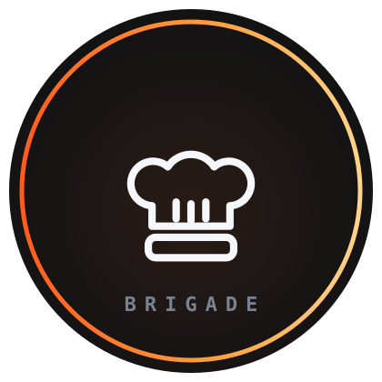

Brigade is a Claude Code plugin that turns your session into the planner of a parallel coding fleet. Point it at a ticket, and scouts research, cooks implement small packets in their own git worktrees, an inspector reviews every diff, and you get one PR to review.

You keep two jobs: approve the plan, and review the PR. Everything in between runs on cheap subagents, with real command output as evidence at every step.

## What you can do

- **Cook a ticket end to end.** Say `work my board`, pick a ticket, approve the split, and parallel cooks take it to one reviewed PR. See [Run a dish](usage.md).
- **Groom a board.** Cluster, split, merge and sharpen tickets until they are ready to cook, one confirmed batch at a time. See [Grooming](grooming.md).
- **Plan a whole initiative.** `/brigade:roadmap` turns an intent into epics and drills them down into cookable tickets, with an offline HTML view. See [Roadmaps](roadmap.md).
- **Review a branch.** `/brigade:review` reviews a branch, PR or commit range along named dimensions, and `/brigade:review-dispatch` cooks the findings you pick. See [Reviews](reviews.md).

It works with Notion, ClickUp, an Obsidian vault, or a plain folder of markdown files, so you can try it with no service and no token.

## Where to go next

### Get started

- [Quickstart](quickstart.md): from nothing to a landed change in ten minutes, using a local board.
- [Installation](installation.md): requirements, installing, updating, and upgrading open work.
- [Concepts](concepts.md): the nouns Brigade uses, one or two sentences each.

### Guides

- [Run a dish](usage.md): every phrase, slash command and helper, and what each one does.
- [Roadmaps](roadmap.md): plan an initiative from intent down to ready tickets.
- [Roadmap demo](roadmap-demo.md): a worked roadmap, with its HTML view.
- [Grooming](grooming.md): get a messy board ready to cook.
- [Design and UI](design-and-ui.md): swag a design or iterate a front-end ticket live before anyone cooks.
- [Reviews](reviews.md): review a branch, PR or range, and dispatch the findings.

### Configure

- [Configuration](configuration.md): the settings layers, every key, and how to see which layer won.
- [Overrides](overrides.md): prompt and agent overrides that stack across layers.
- [Tiers](tiers.md): how much model each dish buys, and how to change one row.
- [Sources](sources.md): ticket boards and the four-operation adapter contract.

### Reference

- [Commands](commands.md): every `/brigade:` slash command.
- [Scripts](scripts.md): the zero-token helper scripts.
- [Artifacts](artifacts.md): the files a dish, review or roadmap writes, and their schemas.

### Under the hood

- [Architecture](architecture.md): the pipeline, the roles, the git model, and why it is built this way.
- [Intent](intent.md): what Brigade optimizes for, its bet, and its non-goals.
- [Experiments](experiments.md): the hypotheses the fleet has tested, with results and decisions.

### Help

- [Troubleshooting](troubleshooting.md): blocked items, stopped runs, config that seems ignored, landing failures.
