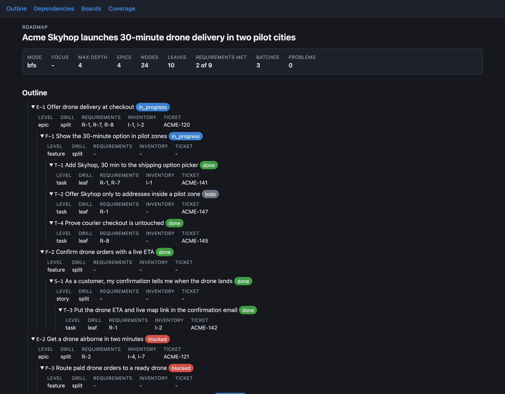
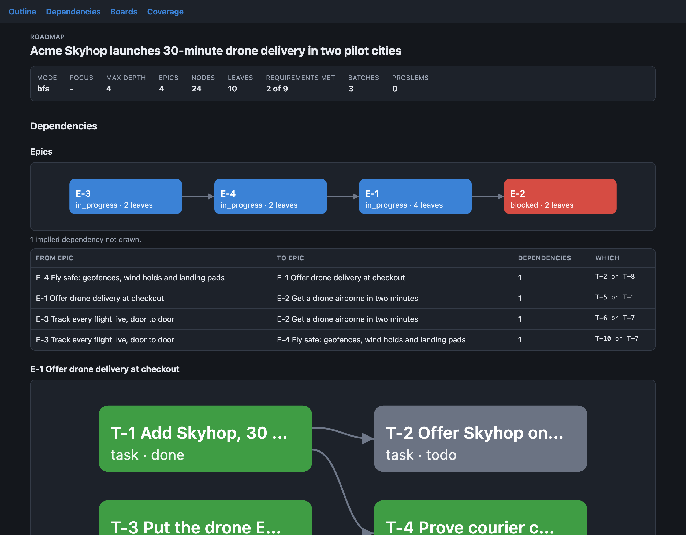
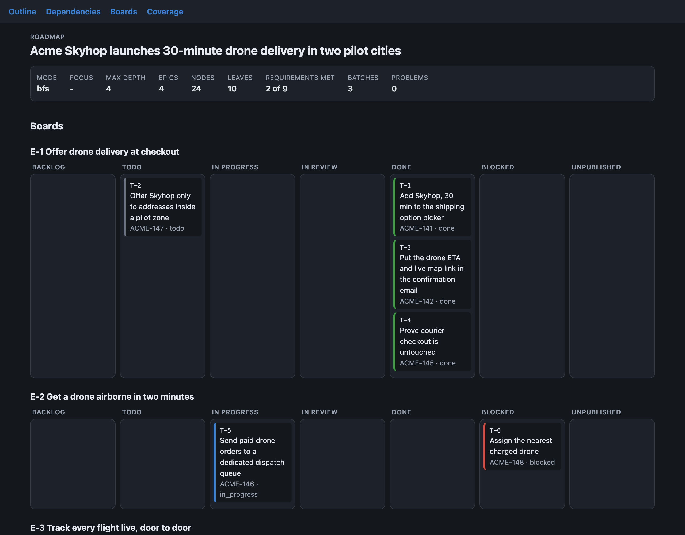
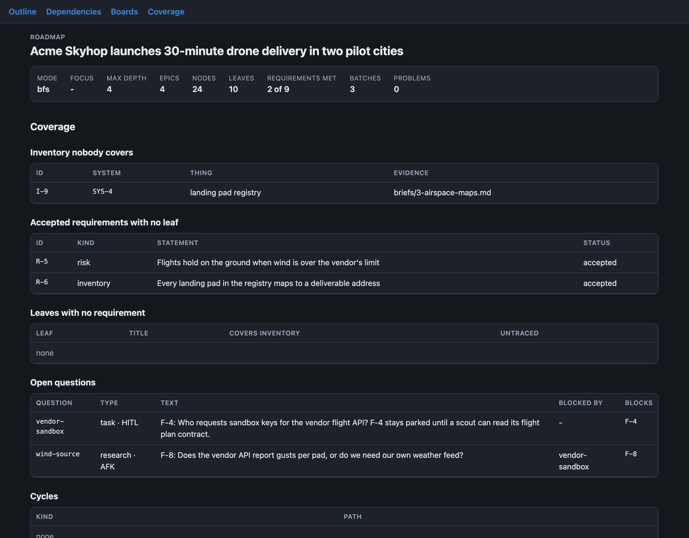

From one sentence of intent to a board of cookable tickets. This tour walks a complete sample roadmap, Acme Skyhop's 30-minute drone delivery launch, through every step of a `/brigade:roadmap` session, with real output from the real commands.

The roadmap ships with the plugin at [`skills/roadmap/examples/launch-demo/`](../skills/roadmap/examples/launch-demo/). Acme, Skyhop and every system in it are made up. For the reference behind each step, see [Roadmaps](roadmap.md).

## The pitch: one sentence in

Here is everything the operator said, pasted verbatim into `## Original request`:

```text
We want drone delivery live in the two pilot cities by launch day. Checkout offers it inside the
zones, dispatch gets a drone up fast, customers can watch it come in, and nothing flies where it
should not. Don't break courier orders while we do it.
```

Three sentences, no tickets, five systems nobody has listed yet. That is exactly the kind of work too big for a single dish.

## Grill it into requirements

The two-hat grill turns that paragraph into commitments you can check. The product hat pins down what done looks like; the architect hat asks how each one is proven. Out came nine requirements:

| id | kind | statement | status |
|----|------|-----------|--------|
| R-1 | functional | Customers inside a pilot zone see a 30-minute drone option at checkout | accepted |
| R-2 | functional | A paid drone order has a charged drone assigned within two minutes | accepted |
| R-3 | functional | Customers watch their drone on a live map that updates at least every 5 seconds | accepted |
| R-4 | risk | No flight plan crosses a no-fly zone, and a geofence breach aborts the flight | accepted |
| R-5 | risk | Flights hold on the ground when wind is over the vendor's limit | accepted |
| R-6 | inventory | Every landing pad in the registry maps to a deliverable address | accepted |
| R-7 | constraint | Checkout p95 latency grows by no more than 50 ms | accepted |
| R-8 | parity | Courier orders check out and notify exactly as they do today | accepted |
| R-9 | functional | Customers choose a delivery time window for drone orders | dropped |

Notice R-9. Somebody wanted time windows; the grill surfaced it, and the operator dropped it at the epics confirmation with a recorded decision (`no-time-windows`). Scope creep, caught on day one.

## Map every system, not just the repos

Drone delivery touches far more than code. The Systems table names five systems of four different kinds, each with the one read-only command a scout may run:

| id | kind | locator | command | access |
|----|------|---------|---------|--------|
| SYS-1 | repo | acme/storefront | `git ls-files src/checkout` | ok |
| SYS-2 | repo | acme/dispatch | `git ls-files services` | ok |
| SYS-3 | message stream | topics drone.* | `list-topics --prefix drone.` | ok |
| SYS-4 | object storage | bucket airspace-maps | `list-objects airspace-maps/ \| head` | ok |
| SYS-5 | vendor API | drone vendor flight API, sandbox | `flight-api status --env sandbox` | missing |

SYS-5 reads `missing`: nobody has sandbox keys for the vendor's flight API yet. That doesn't stall the roadmap. It becomes one named open question, `vendor-sandbox`, and parks only the work that needs the vendor API.

## Inventory with receipts

Three scouts went out, one per question, and came back with evidence: the literal command and its sanitized output. Here is the airspace scout's anchor:

```text
$ list-objects airspace-maps/ | head
airspace-maps/city-a/no-fly.geojson
airspace-maps/city-a/pilot-zone.geojson
airspace-maps/city-a/pads.csv
airspace-maps/city-b/no-fly.geojson
airspace-maps/city-b/pilot-zone.geojson
airspace-maps/city-b/pads.csv
```

Those briefs became ten inventory rows: the shipping picker, the confirmation email, the order status screen, the paid order consumer, the courier SMS notifier, two drone topics, no-fly polygons, the landing pad registry and the vendor flight plan endpoint. Every row cites its brief.

Then the boundary. The dispatch scout found that the courier SMS notifier hangs off the courier queue only, so I-5 was excluded with a decision (`sms-stays-courier`) instead of quietly dropped.

## Four epics, one confirmation

The Planner proposed four epics, an inspector sketched its own split blind and compared, and the operator confirmed one batch:

| Epic | Title | Satisfies |
|------|-------|-----------|
| E-1 | Offer drone delivery at checkout | R-1, R-7, R-8 |
| E-2 | Get a drone airborne in two minutes | R-2 |
| E-3 | Track every flight live, door to door | R-3 |
| E-4 | Fly safe: geofences, wind holds and landing pads | R-4, R-5, R-6 |

The inspector earned its keep. From batch 1's dispositions: its finding that T-6 assigned drones without charge data was folded in, so T-6 now depends on the telemetry consumer and covers the `drone.battery` topic.

## Drill a round, publish in order

The operator chose `bfs`, so every epic got sized before any branch ran deep. Round one created nine features, a story and ten ready tasks, and published the four epic tickets plus T-1, the shipping picker change, so checkout work could start that same day.

Every leaf carries a full ticket body. Here is T-1's context line, the portable record every board understands:

```text
Roadmap: skyhop-launch/T-1 | Offer drone delivery at checkout > Show the 30-minute option in pilot zones | satisfies R-1, R-7 | blocked by none
```

Batch 2 published seven more leaves in dependency order: the prerequisites nobody waits on first (T-3, T-7 and T-8), then T-4, T-5, T-2 and T-6. Its linking pass wrote each prerequisite's ticket into its dependents' `blocked_by`, so T-6, which waits on the dispatch queue and the telemetry consumer, now reads:

```text
Roadmap: skyhop-launch/T-6 | Get a drone airborne in two minutes > Route paid drone orders to a ready drone | satisfies R-2 | blocked by ACME-146, ACME-143
```

Confirm the links hold:

```bash
scripts/brigade-roadmap links skills/roadmap/examples/launch-demo
```

```text
links OK: 12 published nodes checked
```

Batch 3 drills the two open features, F-6 and F-9, and sits at `proposed`, waiting on the operator.

## What `next` hands you

Ask the roadmap what to drill next:

```bash
scripts/brigade-roadmap next skills/roadmap/examples/launch-demo
```

```text
batch (bfs): 2 nodes
  F-6  Put the live map on the order status screen
  F-9  Register landing pads for pilot addresses
parked: 2 nodes
  F-4  Hand flight plans to the vendor flight API — vendor-sandbox
  F-8  Hold flights in high wind — wind-source
```

Two nodes ready to drill, two parked, and the exact question parking each one. F-8 waits on `wind-source`, which itself waits on `vendor-sandbox`: get those sandbox keys and both branches unlock.

## Where it stands: `status`

```bash
scripts/brigade-roadmap status skills/roadmap/examples/launch-demo
```

```text
epics:
  E-1    in_progress Offer drone delivery at checkout
  E-2    blocked     Get a drone airborne in two minutes
  E-3    in_progress Track every flight live, door to door
  E-4    in_progress Fly safe: geofences, wind holds and landing pads
requirements:
  R-1    unmet       accepted  Customers inside a pilot zone see a 30-minute drone option at checkout
  R-2    unmet       accepted  A paid drone order has a charged drone assigned within two minutes
  R-3    unmet       accepted  Customers watch their drone on a live map that updates at least every 5 seconds
  R-4    unmet       accepted  No flight plan crosses a no-fly zone, and a geofence breach aborts the flight
  R-5    unmet       accepted  Flights hold on the ground when wind is over the vendor's limit
  R-6    unmet       accepted  Every landing pad in the registry maps to a deliverable address
  R-7    met         accepted  Checkout p95 latency grows by no more than 50 ms
  R-8    met         accepted  Courier orders check out and notify exactly as they do today
  R-9    unmet       dropped   Customers choose a delivery time window for drone orders
```

Work is moving: T-1, T-3 and T-4 are done, T-7 is in review, T-5 and T-8 are in progress. That is enough for two requirements to flip to `met`: R-7 (checkout latency, satisfied by T-1) and R-8 (courier parity, satisfied by T-4). E-2 shows `blocked` because its T-6 ticket is blocked. R-1 stays `unmet` until T-2, still in `todo`, is done too.

Epic status is derived from the leaves under it; a requirement is `met` only when every leaf that satisfies it is done. Nobody types these by hand, so nobody can fudge them.

## Is it sound? Is it done? `check` and `check --complete`

`check` asks whether the roadmap is well formed: no dangling ids, no cycles, every leaf ready.

```bash
scripts/brigade-roadmap check skills/roadmap/examples/launch-demo
```

```text
roadmap OK: 24 nodes, 10 leaves ready
```

`check --complete` asks the harder question: is there anything left to do?

```bash
scripts/brigade-roadmap check --complete skills/roadmap/examples/launch-demo
```

```text
parked_node: F-4: parked by vendor-sandbox
open_node: F-6: drill is still open
open_node: F-8: drill is still open
open_node: F-9: drill is still open
uncovered_inventory: I-9: no node covers this inventory row and no decision excludes it
uncovered_inventory: I-10: no node covers this inventory row and no decision excludes it
unsatisfied_requirement: R-5: accepted requirement with no leaf satisfying it
unsatisfied_requirement: R-6: accepted requirement with no leaf satisfying it
unpublished_leaf: T-9: ready leaf has no ticket
unpublished_leaf: T-10: ready leaf has no ticket
```

It exits 1, and that is the point. Every line is a to-do with a reason:

- `parked_node` and `open_node` are the branches still waiting on a question or a drill round.
- `uncovered_inventory` flags I-9, the landing pad registry nobody owns yet, and I-10, the vendor flight plan endpoint. F-4 does cover I-10, but F-4 is parked, and a parked branch covers nothing: nobody has committed to that work.
- `unsatisfied_requirement` names the commitments with no leaf behind them: wind holds (R-5) and landing pads (R-6).
- `unpublished_leaf` lists ready work that isn't on the board yet: T-9 (push positions every 5 seconds) and T-10 (abort on a geofence breach). Their prerequisites are published, so they can go out in the next publish batch.

A roadmap is finished when this command exits 0. Until then, it tells you exactly why not.

## See it: the roadmap view

One command renders the whole roadmap as an offline HTML page with four views, headed by the roadmap's title and a row of counts: epics, nodes, leaves, requirements met, batches and problems.

### Outline



The full tree, epic to task, with each node's drill state, requirements, inventory and ticket. Status pills roll up from the leaves: E-1 shows `in_progress` because T-1, T-3 and T-4 are done while T-2 is still in `todo`.

### Dependencies



The epic graph up top shows which epics wait on which, colored by derived status, and the table under it names the exact task-level edges behind each arrow (T-2 on T-8, T-5 on T-1, T-6 on T-7). Below that, one graph per epic shows its leaves in order.

### Boards



Each epic's leaves in board lanes, straight from the ticket statuses: T-1, T-3 and T-4 in Done, T-7 in review, T-5 and T-8 in progress, T-2 in Todo, T-6 in Blocked. T-9 and T-10 sit in Unpublished, ready work waiting for their publish batch.

### Coverage



The traceability gaps in one place: the landing pad registry nobody covers, the two requirements with no leaf, the two open questions with the nodes each one blocks, and which requirements are already met. No leaf lacks a requirement, and there are no cycles.

## Try it yourself

From a clone of the plugin (or `"$CLAUDE_PLUGIN_ROOT"` inside a Claude Code session), run the same commands against the demo:

```bash
cd /path/to/brigade
scripts/brigade-roadmap next skills/roadmap/examples/launch-demo
scripts/brigade-roadmap status skills/roadmap/examples/launch-demo
scripts/brigade-roadmap check --complete skills/roadmap/examples/launch-demo
scripts/brigade-roadmap-view skills/roadmap/examples/launch-demo --out /tmp/skyhop.html
```

Open `/tmp/skyhop.html` in a browser and click through the four views. The scripts need only Node.

Ready to plan your own initiative? Read [Roadmaps](roadmap.md), then run `/brigade:roadmap <slug>` in your repo.
