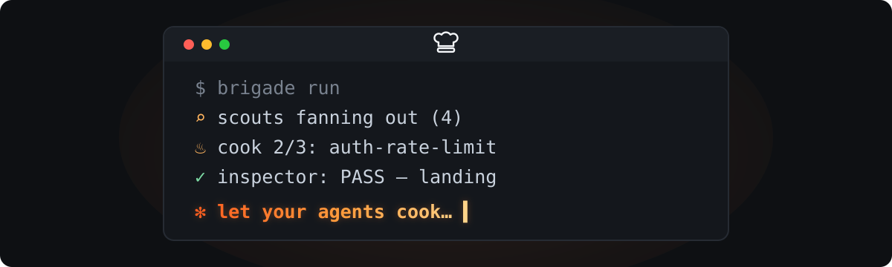

This page walks one ticket from "go" to an open pull request: what to say, what Brigade does at each phase, and the two moments it stops for you. Every slash command lives in [Commands](commands.md) and every helper script in [Scripts](scripts.md).



## Who you are talking to

You talk to the **Planner**, which is your Claude Code (or Codex) session itself. It never reads source to get oriented and never writes product code. It plans, dispatches subagents, reads their artifacts and reports back. Scouts research, cooks implement in their own git worktrees, and an inspector reviews every diff before it lands.

A **dish** is one ticket cooked to completion. Everything Brigade writes for it lives under `.brigade/dishes/<dish-slug>/`, which is never committed.

## Start a dish

Say one of these in a repo where Brigade is set up (run `/brigade:onboard` first if it is not):

| Say | What happens |
| --- | --- |
| `work my board` or `work my tickets` | Lists your assigned tickets and runs the dish on the one you pick |
| `brigade ACME-142` | Starts straight on the named ticket |
| `parallelize this ticket` or `run the fleet` | Same as above, for the ticket you are already discussing |
| `brigade heavy` | Runs this one dish at ★★★ |
| `brigade light` | Runs this one dish at ★ |
| `continue the dish` | Resumes a dish from its files, in any session |

`brigade heavy` and `brigade light` override the repo's tier for one dish only. A whole board goes to [grooming](grooming.md) first, and a ticket that needs a first design cut goes to [design swag](design-and-ui.md).

## Follow the five phases

The Planner copies a checklist into its first message and ticks it off as it goes:

```text
- [ ] 0 Intake
- [ ] 1 Research
- [ ] 2 Decompose
- [ ] 3 to 5 Execute
- [ ] 6 Handoff
```

### Intake

The Planner settles which ticket (the one you named, the one already in progress, or the only one assigned to you; otherwise it asks), reads it once and claims it: assignee set to you, `kind` set, status moved to in progress.

It then sweeps your other open tickets for overlap and records one decision for each: absorb it, cross-reference it, or leave it. A raw idea instead of a ticket gets a short interview first: a product round (who it is for, what success looks like, what is out of scope), then an architecture round (what it touches, how each criterion gets checked).

### Research

The Planner writes the smallest set of focused questions the plan needs and sends each to a scout. Scouts read the codebase in parallel and return short briefs with pasted signatures and file anchors. Your tier caps how many run, and anything dropped is logged. You only hear from the Planner here if a genuine unknown changes scope.

### Decompose

The Planner splits the ticket into work items. Each item touches one to three named files, does one thing, carries everything the cook needs (pasted contracts, anchors, exact verify commands), and can be checked mechanically. Items in the same wave never share a file; overlap becomes a dependency edge. An item that is still one behavior but big or risky is flagged heavy and goes to the stronger cook from the start. The full rulebook is [DECOMPOSE.md](../skills/brigade/DECOMPOSE.md).

When the tier calls for one, an inspector runs a **plan check** before you see the plan: it sketches its own decomposition blind, compares it with the Planner's, and executes the packets' checks against the real tree. Every finding gets a written ruling in the plan.

### Execute

After you approve, a workflow runs the whole dependency graph without stopping to ask: a worktree per item, a cook, an inspector verdict, a retry or a stronger cook on failure, then a rebase and fast-forward onto the delivery branch, one landing at a time. It refuses to land if anything outside `.brigade/` is dirty in your main checkout.

Repeated failure trips a circuit breaker. That means the plan's premises were wrong, so the Planner re-plans from first principles instead of burning another attempt.

### Handoff

The Planner proves the gate at full scope on the delivery branch, has an inspector check every acceptance criterion, runs the red team, opens one draft PR with a checked body, moves the ticket to in review with a plain-language comment, and runs the analyst retro when your tier calls for one. See [Hand off the branch](#hand-off-the-branch) below.

## Approve at the checkpoints

A plain dish stops for you twice:

1. **The plan.** At the end of Decompose you see item titles, dependency edges, the wave layout, heavy flags and the plan check verdict. One yes starts execution, and nothing stops again until handoff unless a stop condition fires.
2. **The pull request.** You review it like any other PR.

A dish that changes a shared interface plans one level at a time. It first shows you only the **contract** items (the interface, the decisions made, the questions parked for later). After those merge, it writes the implementation items and asks once more. A dish with no contract item has a single plan checkpoint.

Between approval and handoff, the Planner interrupts only for: a collision with another dish or branch, a blocked item that needs a value it will not guess, a rebase conflict it must resolve by hand, an item whose retries all failed, or the circuit breaker. A blocked item always comes back as one decision-ready question: the exact value needed, the options, and a recommendation.

## Resume a dish

Say `continue the dish` in any session, Claude Code or Codex. Resume is mechanical:

1. The Planner runs `brigade-status` and `brigade-coord list`, takes the dish lease, and reads its own ledger at `state/planner.md` (the facts it already verified).
2. It reads `PLAN.md` only for the items it is about to act on, and reconciles them against the worktrees, branches and reports on disk. When the files and the plan disagree, the files win.
3. It tells you in two lines where the dish stands, then carries on from the current phase.

Approved levels are never re-planned and landed items are never re-cooked. A ticket sent back from review (`rework`) or approved for landing (`merging`) resumes at the matching step of [HANDOFF.md](../skills/brigade/HANDOFF.md).

Undo is git, not `/rewind`. Cooks edit in worktrees and landings are git merges, so checkpointing never sees them. Reset the delivery branch, drop an item branch or revert a merge instead.

## Watch the plan page

`brigade-plan-view` renders a `PLAN.md` as one self-contained HTML page: dish facts, status counts, a dependency graph, the items table and the parked questions. It writes `plan.html` next to the plan by default (or wherever `--out` points) and is never committed. The scripts are not on your `PATH`; [Scripts](scripts.md) shows how to call them from your own terminal.

```bash
"$CLAUDE_PLUGIN_ROOT/scripts/brigade-plan-view" .brigade/dishes/<dish-slug>/PLAN.md
"$CLAUDE_PLUGIN_ROOT/scripts/brigade-plan-view" --out .brigade/acme-142.html .brigade/dishes/<dish-slug>/PLAN.md
```

The Planner re-renders it after every plan change and republishes it to the same page. A comment you leave on that page becomes a plan edit or a parked question, never a silent drop.

## Watch the live board

Run `/brigade-board` to open the task board in a pane beside the chat. It shows every agent on the dish as a sprite with its role and what it is working on, the work items moving through their lanes, recent messages from the dish folder, and how full the session's context is. It only reads: nothing on the board changes a ticket or a plan.


## Rehearse a plan before it runs

`brigade-rehearse` runs the pipeline's own mechanical checks over a whole plan before anything is dispatched. It cooks nothing and changes nothing. The plan check runs it first, and you can run it yourself from inside the repo:

```bash
"$CLAUDE_PLUGIN_ROOT/scripts/brigade-rehearse" .brigade/dishes/<dish-slug>/PLAN.md
"$CLAUDE_PLUGIN_ROOT/scripts/brigade-rehearse" .brigade/dishes/<dish-slug>/PLAN.md --base main --json
"$CLAUDE_PLUGIN_ROOT/scripts/brigade-rehearse" .brigade/dishes/<dish-slug>/PLAN.md --no-exec
```

It compares the plan against the base branch (the plan's `delivery_branch`, falling back to the main line when that branch does not exist yet) and prints one line per finding:

| Check | What it catches |
| --- | --- |
| `validate` | Anything `brigade-validate` fails on the plan |
| `premise` | A file marked `(edit)` that is missing on the base, or `(create)` that already exists |
| `owner` | A non-contract item listing a path a contract item owns |
| `overlap` | Two independent items listing the same file |
| `chain` | One file listed by three or more items (a warning) |
| `risk` | An item the risk table escalates that is not flagged heavy |
| `pin` | Tests outside an item's files that mention a file it edits (a warning) |
| `premise FAIL` | A packet's premise line that exits non-zero on the base |
| `verify UNRUNNABLE` | A Verify command that cannot run on the base for a reason the change will not fix |
| `verify incomplete` | A Verify line that never ran because the block ended early |

**Premise lines.** A packet that depends on a fact about the tree states it as a runnable check under its header lines. The command exits 0 when the fact holds:

```markdown
- **premise:** `grep -q 'export function exportOrders' src/orders/api.ts`
```

**The Verify runner.** Premises and Verify blocks run in a temporary detached worktree of the base, reset before each packet so nothing leaks between them. Each Verify block runs as one script with lines in order, so `cd` and variables carry over, and `set -e` is turned back off after every line so an expected failure never ends the block. Each premise and block gets 60 seconds. `--no-exec` skips running them.

**Pin warnings.** A pin warning names the test files that mention a file the item edits but are not in its file list. The cook may have to change behavior those tests pin, so either add the tests to the item or confirm they should stay untouched.

Exit codes: 0 means no findings (warnings allowed), 1 means findings, 2 means a usage or I/O error. Every finding needs a disposition row in the plan, like any plan-check finding.

## Set up the verification gate

The gate is the list of exact commands a cook must run and paste real output from. It lives under `## Repo` in `.brigade/config.md`; a `gate` key in a JSON config layer wins over it (see [Configuration](configuration.md)):

```markdown
## Repo

- main_branch: main
- verification_gate:
  - npm run typecheck
  - npm run lint
  - npm test
```

One pattern keeps the gate honest as it grows: put every command in one script that stops at the first failure and prints a final line when all of them pass. Brigade's own repo does this with `test/gate.sh`, which ends by printing `GATE OK`. The same shape for a Node project:

```bash
#!/usr/bin/env bash
set -e
cd "$(dirname "$0")/.."
npm run typecheck
npm run lint
npm test
echo "GATE OK"
```

Then list it as the gate (`- ./test/gate.sh`). Two things to know:

- **Scope is checked, not assumed.** `brigade-evidence` classifies every gate command. `npm test -- --filter orders` is `targeted` and never counts as repo green, even though it exits 0 like the full suite.
- **A wrapper script reads as a test run.** `brigade-evidence` cannot see inside `./test/gate.sh`, so a handoff that claims lint and typecheck coverage fails on it alone. List the lint and typecheck commands next to the script, or claim only what the script proves.

## Hand off the branch

Handoff runs in this order, and the PR stays a draft until the last step is clean:

1. **Prove the gate** on the delivery branch at full scope. A red gate with several landed items is bisected to the first bad commit, and that item goes back to rework.
2. **Acceptance pass.** An inspector gives every acceptance criterion and every ticket test plan line exactly one verdict: verified with evidence, covered by a named test, or not verified. Anything not verified gets fixed first.
3. **Red team.** Two fresh reviews of the whole delivery range: a find pass in a tool other than the one that wrote the code, then a verify pass in a tool other than the find pass's. Surviving errors become rework items, each starting with a test that fails on the reviewed head. A new head means a new review. Details in [Reviews](reviews.md#the-handoff-red-team).
4. **PR body.** Rendered from the configured template and checked with `brigade-pr check` before anyone sees it. The PR opens as a draft and is marked ready only when `brigade-pr check --pr <n> --ready` passes, which needs a clean red-team verdict or a human override on the current head.
5. **Ticket.** Moved to in review with a plain-language comment: what changed, how it was verified, how to review. Out-of-scope notes become filed, covered or dropped follow-ups.

## Pick a tier

A tier sets how much model each dish buys: ★★ two-star is the default, ★★★ three-star (`brigade heavy`) adds a stronger first cook, an always-on plan check and an intensive retro, and ★ one-star (`brigade light`) trims scouts and skips the plan check for mechanical work. The roles never change, only the spend. Set the repo default with `/brigade:tier`. The full table is in [Tiers](tiers.md).

## Upgrade open work after a plugin update

After `claude plugin update brigade@brigade` and a new session, the session start says when the new version changes what open tickets and dishes should contain. Say `upgrade my open work` or run `/brigade:upgrade`: it shows one table of changes, applies them after your yes, and never claims, cooks or moves a ticket.

## Worked example: ACME-142

You say `brigade ACME-142`. The ticket reads "Add CSV export to the orders page".

1. **Intake.** The Planner claims ACME-142 and finds ACME-118 ("Export orders as PDF") in your queue. It records a cross-reference, not an absorb: different format, same button row.
2. **Research.** Two scouts answer "where is the orders table's data loaded and in what shape?" and "how do the existing download endpoints set headers?".
3. **Decompose.** Three items: `csv-serializer` (a pure function plus its test), `export-endpoint` (depends on the serializer), and `export-button` (depends on the endpoint). `export-endpoint` carries a premise that the orders query exists:

   ```markdown
   - **premise:** `grep -q 'export function listOrders' src/orders/query.ts`
   ```

   `brigade-rehearse` passes, apart from one pin warning: `test/orders/page.test.tsx` mentions the page the button item edits. The Planner adds that test to the item's files. You approve the plan.
4. **Execute.** The serializer lands first, then the endpoint after one inspector FAIL (a missing header), then the button.
5. **Handoff.** `./test/gate.sh` prints `GATE OK`, the acceptance pass verifies all four criteria, the red team comes back clean, and a PR opens from `feat/orders-csv-export` with ACME-142 in review.
